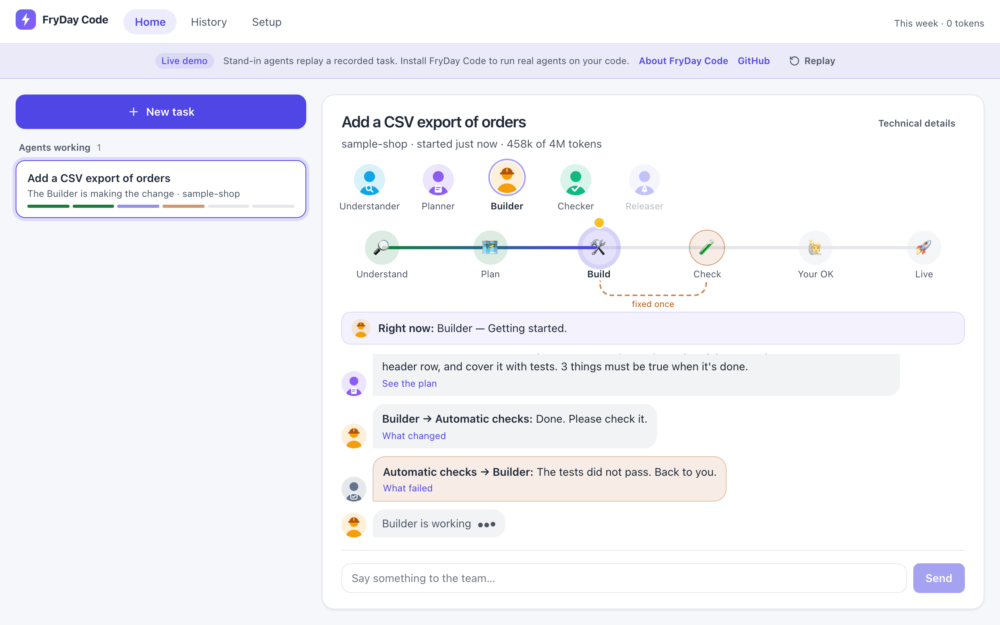
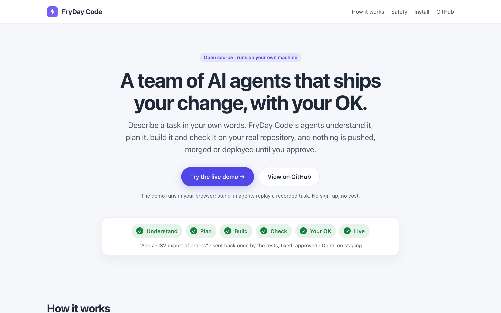
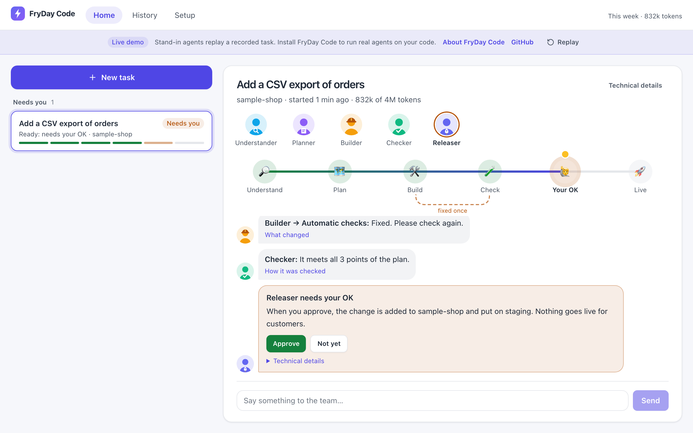
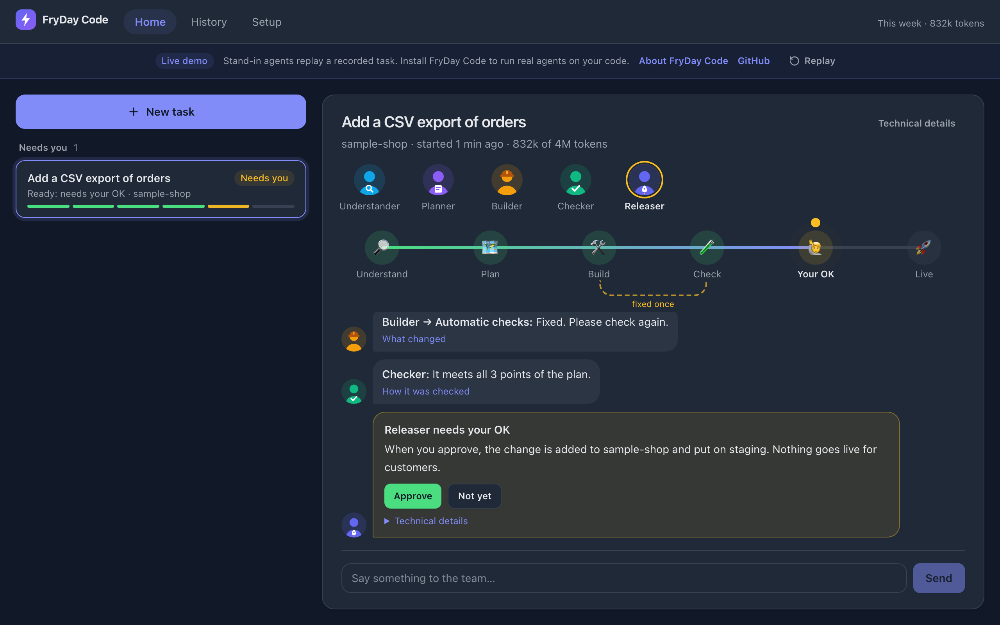
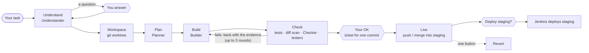

<p align="center">
  
</p>

<h1 align="center">FryDay Code</h1>

<p align="center">
  <b>A local team of AI agents that plans, builds, checks and releases changes to your own repositories,<br>
  with your approval before anything is pushed, merged or deployed.</b>
</p>

<p align="center">
  <a href="https://github.com/MONU8OO8/fryday-code/actions/workflows/ci.yml"></a>
  <a href="LICENSE"></a>
  
  
</p>

<p align="center">
  <a href="https://monu8oo8.github.io/fryday-code/"><b>Try the live demo</b></a> ·
  <a href="#install">Install</a> ·
  <a href="#how-it-works">How it works</a> ·
  <a href="#safe-by-design">Safe by design</a> ·
  <a href="docs/architecture.md">Architecture</a>
</p>

You give FryDay Code a task for one of your repositories, in your own words. An **Understander**
works out what is asked, a **Planner** writes the plan, a **Builder** writes the change, the project's
own tests and a **Checker** check it, and testers try it out running. Then it asks you before anything
is pushed, merged into staging or deployed.

It runs entirely on your own machine, as you, using the Claude Code CLI you are already signed in to.
Every agent works in a sandbox, in a copy of your repository; your own checkout is never touched.



## Try the live demo

**[monu8oo8.github.io/fryday-code](https://monu8oo8.github.io/fryday-code/)** replays a recorded task in
your browser: a question for you, a plan, a first build that fails the tests, a fix, a check, then your
approval. It needs no account, makes no AI calls and sends nothing anywhere.

Or run the same demo locally with `npx fryday-code demo` (see [Install](#install)).

| The landing page | Your approval, in plain words | Dark mode |
| --- | --- | --- |
|  |  |  |

## What it does

- **Understands the task.** Reads what you wrote and any documents you attached (Markdown, text,
  PDF), works out which project it is for when you did not say, lists what is required and notes what
  it had to assume. If something only you can decide would change what gets built, it asks (at most
  twice), and nothing is built until you answer or tell it to go ahead.
- **Finds existing work.** Looks at the branches on the remote; if one already holds part of the
  task, you are asked whether to continue on it. You can also name the branch yourself.
- **Plans, builds and checks in a loop.** A short design with acceptance criteria and a test plan; the
  change written in a workspace of its own; the project's own test, lint and typecheck commands; a
  review against every criterion; and, for a project with a run profile, testers that use the running
  service and its pages. Anything that fails goes back to the Builder with the evidence, up to 3 rounds,
  then to you.
- **Asks before anything is pushed, merged or deployed.** A ticket for one exact commit, listing every push it
  will make and the Jenkins job it will start. One yes takes a change all the way to the staging server;
  Settings can switch that to a separate yes for every step.
- **Deploys staging with Jenkins**, stage by stage, and never answers a prompt about production. A project
  with no Jenkins job set gets its job found for it: the one that builds the project's repository.
- **Does what you tell it in the task chat.** "approve", "deploy it", "try the deploy again", "stop": the
  team lead carries it out, under the same rules as the buttons.
- **Keeps you in the loop** with toasts, desktop notifications and, if you like, a Google Chat space,
  where you can also give tasks and approve with a one-time code.
- **Runs a board, not just a chat.** Every task sits in a column of the board with a priority. Tasks can
  wait for each other ("start after T-3 passes its review", "staging after T-3"), and a scheduler starts
  queued tasks set to start automatically, by priority, as agent slots and the machine allow. A task
  that needs changes in several projects becomes an initiative with one sub-task per project, split by
  you or suggested by the Understander and confirmed by you.
- **Watches the machine.** CPU, memory (with macOS memory pressure), disk and each running agent's own
  CPU and memory, live in the header and on the Health page. New work waits while the machine is short
  of memory or disk.
- **Shows its work.** A team chat in plain words on each task, and every agent's steps, tokens and time on
  the task page. The Agents page has one lane per agent: what it is doing now, its recent runs (each
  opening every step it took, the files it changed, the commands it ran with their exit codes, its
  report and the Builder's diff for that round), and a scorecard for the last 7 and 30 days: how often
  the Builder's first round passes, rounds to pass, what sends work back, tokens per task and runs
  stopped at a limit. Each task shows its acceptance criteria next to the planned tests and what the
  Checker and testers found for each.
- **Knows your projects without re-reading them.** Core reads each project's production branch without
  running anything from it (packages, scripts, env key names, routes, the services it calls) and draws
  which project calls which on the Graph page. Links it guessed from names stay dashed until you confirm
  them; your edits survive every rescan. Agents get a short map of the project and its neighbours
  instead of exploring the repository again.
- **Files and fixes the bugs it finds.** A check that already fails on your production branch, or a
  problem a tester sees that the task did not cause, becomes a bug card of its own (once per kind of
  problem, at most three per task and five a day, Settings can change or switch it off). The scheduler
  picks it up like any auto-start task. A bug from a failing check is run again on production first, and
  closed without starting an agent when it passes now; the agents confirm any other bug before they
  change code. The board filters bugs and shows who found each one, and where. Nothing a bug card does
  is pushed or deployed without your yes.
- **Spends fewer tokens.** Each project's code is indexed (keyword search with SQLite FTS5, search by
  meaning with a small embedding model that runs on your machine; no code leaves it). The Planner and the
  Builder are handed the code a task is about instead of exploring for it, a later Builder round starts
  fresh from a short summary instead of carrying the whole earlier conversation, the Checker re-checks only
  what changed since its last review, and finished tasks are remembered for the next like them.
  `npm run token-bench` measures tokens per finished task.
- **Learns, with you as the gate.** The Builder rates its own work against each criterion, and its
  scorecard shows how often it was right. When a task is sent back, stopped or fails a round, the
  Reflector, an agent with no tools at all, reads what happened and proposes at most three lessons.
  Nothing reaches an agent until you approve it on the Lessons page, where each lesson shows its
  evidence and, once in use, how often it helped. Lessons that keep not helping are suggested for
  retirement.

## How it works

### The team

| Agent | Role | Can it change code? |
| --- | --- | --- |
| **Understander** (Analyst) | Reads the task and documents, finds the project and any existing branch, asks what is unclear | No (read-only) |
| **Planner** | A short design, the runtime flow, acceptance criteria and a test plan | No (read-only) |
| **Builder** (Coder) | Edits inside the task workspace; no network, no git, no access to your home folder | Yes, in its workspace only |
| **Automatic checks** | The project's own test / lint / typecheck commands, run by core in the sandbox | No |
| **Checker** (Reviewer) | Checks the change against each acceptance criterion and must give evidence; cannot overrule a failing check | No |
| **App tester / Page tester** | Use the running service through its HTTP API, and its pages in Chrome | No |
| **Releaser** | Core itself: push and merge into staging, on your yes | (core, not an agent) |
| **Reflector** | After a task went wrong, proposes lessons for the other agents; you approve each one | No (no tools at all) |

### The journey

Home shows every task on one line: **Understand → Plan → Build → Check → Your OK → Live**.



In more detail:

- **Workspace.** A git worktree cut from the project's production branch, or from the tip of the
  branch being continued. Your own checkout is never touched.
- **Checks.** Run in a sandbox on a clean checkout of exactly what was committed. On a repository that
  is already red, only *new* failures block.
- **Diff scan.** Deleted, skipped or focused tests block the change, and so do added secret files and
  added lines that look like a key or token (the value is never repeated); edits to hooks, CI, package scripts
  or dependencies are flagged for you.
- **Trying it out running.** For a project with a run profile, FryDay Code starts the project as a
  service (in the sandbox, from the reviewed commit). The **App tester** sends requests and checks the
  answers, and can read data you granted it; the **Page tester** opens the pages in Chrome, clicks
  through them and takes screenshots, which appear in the task chat as they are taken. It also tries the
  changed pages at phone width. Then FryDay itself opens every page the Page tester visited on a phone
  (390×844, touch), a tablet (768×1024) and a desktop (1280×800), shows the three screenshots side by side
  in the chat, and checks the layout the same way every time: a page wider than a phone or tablet screen
  goes back to the Builder with the picture; small tap targets, tiny text, a missing mobile viewport,
  console errors and failed requests are reported. When a change touches pages but the project's Page
  tester is off, the chat says so and how to turn it on. Their reports give what was sent and what came
  back for every criterion.
- **Approval.** A ticket for one exact commit, listing every push it will make. If the branch moves,
  the ticket is void.
- **Continued branches.** Work that continued a branch of your own is pushed back to that branch on
  your yes (never forced; if the branch moved or gained someone else's commits, nothing is pushed). A
  branch with anyone else's commits is never pushed to: FryDay Code pushes its own branch and you open
  the pull request. Merging into staging is a separate approval after that.
- **Release.** On your yes, FryDay merges into the staging branch and pushes, without force. A conflict
  stops it. One button reverts it.
- **Deploy.** The yes that merges also deploys: the ticket names the Jenkins job, FryDay starts it (with
  the staging branch as its branch parameter) and follows it, stage by stage. A pipeline prompt that
  names staging outright ("Move to STG") is answered as part of that yes; one that only might be about
  staging is put to you; a prompt that mentions production or asks for values is never answered by
  FryDay. The deploy counts only when the build is shown to contain the merge on staging. A project
  without a job gets one found (the Jenkins job whose builds check out the project's repository, never
  one named for production); the first use of a job FryDay found is yours to approve. With *Every step*
  in Settings, the merge, the deploy and each prompt are asked one by one.
- **Thread.** Every task has one: what was asked and answered, what happened, and a box to tell the
  agents something. The next agent to start reads it.

See [docs/architecture.md](docs/architecture.md) for the components, the data flow and where state lives.

## Safe by design

Agents run on your machine against your real repositories, so the limits are built in, not bolted on:

- **Sandbox.** Every agent's shell, every check and install, and the service under test run in an
  operating-system sandbox ([Anthropic's sandbox runtime](https://github.com/anthropics/sandbox-runtime):
  Seatbelt on macOS, bubblewrap on Linux). No network at all, writes only inside the workspace, your
  home folder unreadable.
- **Guard.** An agent gets only the tools its role needs, and every tool call passes a guard that
  fails closed: reads and writes must stay inside the task workspace, and files that look like secrets
  are refused. Only the two testers get any MCP tool, and only the ones core put in that run's own
  config.
- **No git for agents.** FryDay commits their work itself and never runs a repository's git hooks.
- **Approvals.** Nothing is pushed, merged or deployed without your yes on a ticket bound to one
  commit. Nothing is ever force-pushed.
- **What is sent to the model.** The agents are Claude Code, so the task text, attached documents and
  the code they read are sent to the AI model provider (Anthropic) under your Claude login or API key.
- **Staging only, never production.** A data connection that points at production can never be
  granted (in code and as a database CHECK), and FryDay never answers a Jenkins prompt about
  production.
- **Testers stay on the service.** A tester's shell has no network either. It reaches the service
  under test only through a tool that takes a path, never an address, and does not follow redirects.
  The Page tester's browser is a fresh profile whose traffic all goes to a proxy that drops it, except
  the service under test; that holds for what the page itself does, not only where the agent navigates.
  What a page tried to reach is shown on the round. Local files, extra tabs and code in the browser
  driver are not available to the agent.
- **Local only.** The local API accepts only this machine, and a browser becomes "you" only with a
  one-time launch link. Serving the page grants nothing.

`npm run redteam` runs a real agent against the workspace limits, and `npm run redteam:verify` runs
real tester agents, a real browser and a probe service against the verification limits. Both fail if
anything gets through. To report a security problem, see [SECURITY.md](SECURITY.md).

## Install

### Requirements

- macOS or Linux, or Docker (Windows through Docker or WSL)
- Node.js 22.12 or newer (the sandbox needs it; `.nvmrc` says 22), and git
- On Linux: `bubblewrap`, `socat` and `ripgrep` (the sandbox's own needs; see [Linux and Docker](#linux-and-docker))
- [Claude Code](https://claude.com/claude-code) CLI, signed in (`claude` then `/login`), or
  `ANTHROPIC_API_KEY` set in the environment
- Google Chrome, only if you want pages checked by the Page tester (nothing is downloaded; your own
  Chrome profile is not used). Set `FRYDAY_CHROME` to use another Chrome or Chromium.

Pick one way to install. Each needs Node.js 22.12 or newer and Claude Code; Docker needs Docker and a Claude login or API key.

**From npm** (once the package is published):

```bash
npx fryday-code           # install and start FryDay Code on http://127.0.0.1:7475
npx fryday-code open      # later, or in another browser: a new one-time link
```

Or install it for good with `npm install -g fryday-code`, then run `fryday-code`.

**From a clone:**

```bash
git clone https://github.com/MONU8OO8/fryday-code.git
cd fryday-code
npm run setup     # install both packages and build the UI (once, and after pulling changes)
npm start         # start FryDay Code on http://127.0.0.1:7475
```

**With Docker:** `docker compose up --build -d`; see [Docker](#docker) below.

**Just trying it?** The local demo needs no Claude account and costs nothing. It starts a throwaway
install in `~/.fryday-code-demo` (wiped each time) with a small sample project and stand-in agents that
follow a script for one task (a CSV export of orders): a question for you, a plan, a first build that
fails the tests, a fix, a check, then your approval to merge into the sample's staging branch. The UI
says "Demo mode" at the top. It runs on port 7477, so a real install on 7475 keeps working.

```bash
npx fryday-code demo      # or, in a clone: npm run demo
```

**Check your computer** before the first run (the same checks as Setup → Connections, with the command
that fixes each problem; it exits with 1 while something needed is missing):

```bash
npx fryday-code doctor    # or, in a clone: npm run doctor
```

## Using it

FryDay Code prints a one-time link when it starts. Open it to sign your browser in. Later, or in
another browser:

```bash
npx fryday-code open      # or, in a clone: npm run open
```

Then, in the UI (a new install shows these steps on Home until a project is confirmed):

1. **Setup** (for the developer, once): a checklist of Claude Code, your projects, the Chat space,
   staging deploys, agents and test data. Each step opens the detailed screen (Connections, Projects,
   Settings).
2. **Setup → Your projects → Add project**: give the folder of a clone (or a Git URL to clone). FryDay
   Code works out the branches and the check commands; you correct and confirm them.
3. **Board → New task**: describe the change in your own words. Optionally drop a PRD or notes, pick the
   project (or let FryDay Code work it out) and a priority. Under More options: start it automatically
   when a slot is free, make it wait for other tasks, split it across several projects, or name an
   existing branch to continue.

FryDay Code opens on the **Board**: initiatives on top with their parts, then a column per step
(Backlog, Understand, Plan, Build, Check, Needs you, Live, Done). In the Backlog you set priority, order
and auto-start, or start a task now. Each card shows what it waits for and which agent is on it.
**Health** shows the machine and the scheduler's slots. Opening a task shows your tasks on the left
(Needs you, Agents working, Waiting to start, Done this week) and the task on the right, with its
priority, what it waits for and, for an initiative, its parts. The journey line shows where the task is, and the team chat under it shows what
the agents said to each other, in plain words. Questions and approvals appear in the chat with buttons;
every approval says in plain words what will happen, with the technical list one click away.
**Technical details** opens the full task page: every agent and step in order, the hand-offs and
send-backs, what the working agent is doing right now, and each agent's tokens (and how much came
from cache) and time against its limits; under the Checker, a table ties each acceptance criterion to
its planned tests and to what the Checker and each tester found. **Agents** shows each agent's lane,
runs and scorecard. **Graph** shows which project calls which, for you to confirm or correct.
**Lessons** holds what the Reflector proposed, with its evidence, for you to approve, reword or reject,
and the lessons in use with how often they helped. **History** has finished tasks and where tokens and agent time went, by stage
and by project. The UI follows the system's light or dark mode.

## Configuration

### Setup checklist and connections

FryDay Code has no sign-ins of its own. It uses what is already set up on your machine and checks each
tool by running it: Claude Code (needed), the sandbox (needed), git (needed), the GitHub CLI
(optional), Node, memory, Google Chrome (for the Page tester) and the Cursor CLI (optional). Each
problem comes with the command that fixes it.

**Data the App tester may read.** The same page lists the MCP servers Claude Code knows, by name only.
No agent can use one until you turn it on there:

1. *List its tools*: FryDay Code starts the server once, the way Claude Code does, and asks which tools
   it has.
2. Say what it points at (a local database or staging) and that its database user can only read.
3. Tick the tools the tester gets. A tool that takes SQL only lets one `SELECT`, `SHOW`, `EXPLAIN` or
   `DESCRIBE` through; a tool that looks like it changes data, or where the server points, cannot be
   ticked at all.
4. Choose the projects it is for.

A server whose name says production is never offered. If a server's definition changes in Claude Code
afterwards, everything you chose for it is void until you list its tools again. These checks stop
obvious writes, but an MCP server runs outside the sandbox with its own access: **the real guarantee is
a database user that can only read**. Only servers that start as a local command are supported so far.

### Projects

A project is a clone on your machine plus a few facts: its production branch, its staging branch if it
has one, and the commands that check it. Tasks only start on projects you have confirmed.

**Run profile.** Tick *Start this project and have tester agents use it* on a project and give the
command that starts it (`npm start`, say). FryDay Code passes the port as `PORT`; give a fixed port
only if the service cannot read it. You choose the App tester, the Page tester or both, a path that
answers when the service is up, plain environment values, and optionally a file of local values
(`.env.test`) that is read when the service starts and never copied to an agent. Without a run profile
a change is checked by the commands and by review only, and the approval ticket says so.

What the service under test can do: write inside its own checkout, listen on its port, and talk to
other ports on this machine (a local database). It cannot reach any other machine or read your home
folder. If it does not start with the change but does without it, the round goes back to the Builder
with what it printed; if it does not start either way, the run profile needs you.

**Dependencies.** A task works in its own copy of the repository. For a Node project FryDay Code reuses
your own `node_modules` when the package files match. When they do not (or you have none), it runs the
project's install command in the sandbox, where it can reach only the hosts listed in **Settings →
Dependency installs** (the npm and Yarn registries by default), and keeps the result for the next
checkout with the same package files. Packages from a private registry cannot be installed this way
yet. If dependencies cannot be had at all, the task stops and tells you, rather than judging code it
could not check.

**Seed file.** If `~/.fryday-code/projects.seed.json` exists when FryDay Code first starts, the projects
in it are imported. It is a JSON array:

```json
[
  {
    "id": "my-api",
    "name": "My API",
    "localPath": "/absolute/path/to/your/clone",
    "prodBranch": "main",
    "stgBranch": "staging",
    "testCmd": "npm test",
    "typecheckCmd": "npx --no-install tsc --noEmit",
    "verified": true
  }
]
```

### Models and token limits

**Settings** has one row per agent: model, effort, the most tokens one run may use, and how long it may
run. The defaults put the strongest model where judgement matters (Planner, Checker), a cheaper one on
the Builder (stronger from the third round), and the cheapest on chat. A task also has a token limit of
its own (4M by default). Counted tokens are input + output + cache writes; cache reads are shown apart
as "reused" and never count. When an agent or a task reaches its limit, work stops and you get a
"continue?" ticket; the agent picks up where it stopped if you say yes.

### Agent engines

Every agent runs on Claude Code unless you choose otherwise. In **Settings**, the Understander and the
Planner can be switched to the **Cursor CLI** (`cursor-agent`). It is marked *reduced isolation*,
because Cursor offers no way for FryDay to check each tool call. To make up for that:

- it is offered only for these two read-only agents, never for the Builder, the Checker or the testers;
- it reads a throwaway copy of the code, runs in Cursor's ask mode with writes and shell refused in its
  own settings, and gets no MCP servers;
- the whole program runs in the OS sandbox: it can read only that copy, its install folder and an empty
  home of its own, write only that home, and reach only Cursor's servers;
- its answer is read from the JSON at the end of its last message and checked like any other; an answer
  that is not usable goes to you.

Because it gets an empty home, your Cursor sign-in is not used: paste a User API key from the Cursor
dashboard into **Connections → Other agent engines**. Cursor bills your Cursor plan; its tokens are
still counted, but only when the run ends (see [known limits](#roadmap-and-known-limits)). Running
agents on another machine over SSH is defined but not offered yet.

### Alerts and the Chat space

Every question, decision, stop and finish shows as a toast in the app and a desktop notification
(macOS, or `notify-send` on a Linux desktop; switch it off in Settings), and goes to the Chat space when
one is set up.

**Posting to a Chat space.** In Connections you can paste the incoming-webhook address of a Google Chat
space (space → Apps & integrations → Webhooks). FryDay Code then posts questions, approvals that are
waiting and results there, one thread per task. The address is a secret: it is kept in a file only you
can read and is never shown again.

**Working from the Chat space.** To give tasks and answer there too, set up *Reading the space* on the
same page. FryDay reads the space with your own Google sign-in, read-only; there is no bot, nothing
listens on the internet, and reading costs no model tokens.

1. In your Google Cloud project, enable the Google Chat API, add yourself as a test user on the OAuth
   consent screen, and create an OAuth client of type *Desktop app*. Paste its id and secret.
2. *Sign in with Google.* Google sends the browser back to FryDay on this machine.
3. *Get a link code* and post it in the space yourself. Whoever posts it is the only person FryDay takes
   instructions from; messages from anyone else, and from apps, are skipped.

Then, in the space: `task: <what to do>` gives a task (more lines are its description; a line
`project: <id>` names the project), `status`, `help`. In a task's thread: `approve 123456` or
`decline 123456` with the code from the decision's message, `go ahead`, `1: <answer>`, or
`note: <text>`. Each message is handled once, the same task sent twice within minutes makes one task,
and an approval without the right code does nothing. FryDay looks every 20 seconds while a task waits
for you, and every minute otherwise.

### Jenkins

In Connections: the Jenkins address, a user and that user's API token (Jenkins → your name → Security →
API Token). The token is kept in a file only you can read and is never shown again; *Test* only reads
(who you are, and a job's parameters). Every request goes to that address only: an address Jenkins hands
back is reduced to its path and joined to yours. Use a Jenkins user that may build the staging jobs and
nothing more if you can.

You can leave the deployer empty: with Jenkins connected, FryDay finds the project's job itself the
first time a task there needs it, and tells you which one it took. To set it by hand, on a project with
a staging branch, tick *offer to deploy it with a Jenkins job* and give the job (with
its folders, `team/service-deploy`), the parameter that names the branch (`BRANCH`), and the stage that
is the staging deploy (`Deploy to STG`). With a stage named, the deploy is done once that stage succeeds
and later stages, such as a production deploy waiting for a person, are left alone; without one the
whole build must succeed.

### Where things are kept

Everything FryDay Code stores is in `~/.fryday-code` (change it with `FRYDAY_HOME`): the database, agent
run logs, task worktrees, and a `secret` file that protects the local API. Nothing is sent anywhere
except what the Claude Code CLI itself sends to run the agents (and, if you set them up, the Chat space
and Jenkins). The local demo keeps its own throwaway install in `~/.fryday-code-demo`.

## Linux and Docker

FryDay Code runs the same way on Linux: `npm run setup`, `npm start`, `npm run open` (which uses
`xdg-open` when there is a desktop, and otherwise just prints the link). **Setup → Connections** checks
everything below and gives the command that fixes what is missing.

**Packages.** The sandbox on Linux is [bubblewrap](https://github.com/containers/bubblewrap), with
`socat` for its network bridge and `ripgrep` to find the files it must hide:

| Distribution | Command |
| --- | --- |
| Debian, Ubuntu | `sudo apt-get install -y bubblewrap socat ripgrep git` |
| Fedora | `sudo dnf install -y bubblewrap socat ripgrep git` |
| Arch | `sudo pacman -S bubblewrap socat ripgrep git` |

**Ubuntu 24.04 and later** restrict unprivileged user namespaces through AppArmor, and bubblewrap needs
them. Lift the restriction (the second part keeps it lifted after a restart):

```bash
sudo sysctl -w kernel.apparmor_restrict_unprivileged_userns=0 && echo 'kernel.apparmor_restrict_unprivileged_userns=0' | sudo tee /etc/sysctl.d/60-fryday-userns.conf
```

Some Debian kernels switch user namespaces off with `kernel.unprivileged_userns_clone=0`, and some
hardened systems set `user.max_user_namespaces=0`; Connections names the one to change.

On Linux, keeping the machine awake uses `systemd-inhibit` where there is systemd, and memory pressure
is read from `/proc/pressure/memory`.

**Known limit on Linux: no App or Page tester.** On Linux the sandbox runtime gives every sandboxed
command a network namespace of its own (bubblewrap `--unshare-net`; its `allowLocalBinding` setting is
ignored there). A service under test listening inside it is on a loopback that is not the machine's,
and the runtime's network bridge carries traffic out of the sandbox only, so neither core's service tool
nor the browser can reach it. The one way in would be a Unix socket opened by the sandboxed service,
which the runtime's seccomp filter forbids (rightly, since that would also let agent-written code reach
other sockets on the machine). So on Linux a task whose project has a run profile goes to you after the
review with "the API and UI testers are not available on Linux yet", through the same path as a missing
browser; checks, reviews and everything else work as on a Mac.

### Docker

The image has Node 22, git, the sandbox tools, Chromium and the Claude Code CLI. It runs as an
unprivileged user and keeps everything under that user's home folder, which every sandbox hides from
agents.

```bash
export FRYDAY_PROJECTS=~/code          # the folder that holds your repositories
export ANTHROPIC_API_KEY=...           # or sign in inside the container, below
export GIT_USER_NAME="Your Name" GIT_USER_EMAIL=you@example.com
docker compose up --build -d
docker compose exec fryday npm --prefix /app/core run open -- --print
```

Open the printed link on this machine. Your repositories are at `/home/node/projects/<name>` in the
container; add them under Projects by that path. To use a Claude Code login instead of an API key, run
`docker compose exec fryday claude auth login`; the login is kept in the `claude-login` volume (on a
Linux host you can mount your own `~/.claude` instead, see `docker-compose.yml`). FryDay Code's state is
in the `fryday-state` volume. If git in the container calls a repository "dubious ownership", your user
id is not 1000: run `docker compose exec fryday git config --global --add safe.directory
/home/node/projects/<name>`.

Release images are published to `ghcr.io/monu8oo8/fryday-code` for each version tag.

The port is published on `127.0.0.1` only, and the host port must be the same as `FRYDAY_PORT`
(default 7475): core accepts requests only addressed to `127.0.0.1:<port>` or `localhost:<port>`.

**What is reduced in Docker:**

- The sandbox runs in its nested mode (`enableWeakerNestedSandbox`, switched on only when
  `FRYDAY_IN_DOCKER=1`, which the image sets, and the process is in a container: `/.dockerenv`, or
  PID 1's cgroup naming docker, containerd or kubepods): a container cannot mount a fresh `/proc`, so
  a sandboxed command can see the container's other processes. Files and network stay confined, and the container
  is the outer wall. Connections says "Reduced isolation (nested sandbox)".
- bubblewrap needs user namespaces, which Docker's default seccomp and AppArmor profiles forbid, so
  `docker-compose.yml` runs this container with `seccomp=unconfined` and `apparmor=unconfined`. The
  sandbox's own seccomp filter still applies to every agent command inside it.
- The Linux limit above applies: no App or Page tester. No desktop notifications, and no keeping the
  host awake.

For the strongest isolation, install directly on macOS or Linux.

## Development

```bash
npm run setup       # install core and ui, build the UI
npm run dev         # core, restarted on change
npm run build:ui    # rebuild the UI into core/public after changing ui/
npm run build:demo  # the static demo site into ui/dist-demo (VITE_BASE sets its base path)
npm run typecheck   # core and UI
npm test            # unit and integration tests (real git, real sandbox, stand-in agents)
```

CI runs the typecheck, the tests, the UI build and the demo build on macOS and Ubuntu, and builds and
smoke-tests the Docker image ([workflow](.github/workflows/ci.yml)). `FRYDAY_NETWORK_TESTS=1 npm test`
also runs the one test that needs the npm registry.

**Real-agent checks** use your Claude Code login and tokens, so they are not in CI; run them before a
release, and the ones that match your change before a pull request:

```bash
npm run redteam         # real agent, tries to escape
npm run e2e             # real planner, coder and reviewer on a scratch repo
npm run fresh           # a first run on an empty state folder, through the API only; real agents, real npm
npm run intake          # a PDF PRD with no project named, a vague task, your branch, a teammate's branch
npm run redteam:verify  # real testers, browser and a probe service try to get out; needs Google Chrome
npm run verify          # a planted backend bug and a planted page regression; real testers must catch both
npm run deploy-check    # release and deploy through the API against a stand-in Jenkins; no real Jenkins, no cost
```

They work in `~/.fryday-code/redteam`, `/e2e`, `/fresh`, `/intake-check`, `/redteam-verify`,
`/verify-check` and `/deploy-check`, each with its own database and a throwaway repository whose remote
is a folder on disk. They never push anywhere real.

The demo site's recording is made with `npm run record-demo`, and the screenshots above with
`node scripts/screenshots.mjs`. See [CONTRIBUTING.md](CONTRIBUTING.md) for the security rules every
change must follow, and [docs/design/](docs/design/specs/2026-11-22-simple-ui-design.md) for design notes.

## Tech stack

- **Core:** Node.js 22 and TypeScript run with [tsx](https://tsx.is), [Express](https://expressjs.com) 5,
  SQLite through [better-sqlite3](https://github.com/WiseLibs/better-sqlite3), [zod](https://zod.dev)
- **Agents:** the [Claude Code](https://claude.com/claude-code) CLI (`claude -p`), optionally the
  Cursor CLI for read-only roles
- **Sandbox:** [`@anthropic-ai/sandbox-runtime`](https://www.npmjs.com/package/@anthropic-ai/sandbox-runtime)
  (Seatbelt on macOS, bubblewrap on Linux)
- **Testers:** [`@playwright/mcp`](https://www.npmjs.com/package/@playwright/mcp) with Chrome, behind a
  deny-all proxy; MCP servers you turn on for data
- **UI:** React 18, React Router, [Vite](https://vite.dev), [Tailwind CSS](https://tailwindcss.com),
  [lucide](https://lucide.dev) icons
- **Delivery:** npm package with a CLI, Docker image, GitHub Actions, a static demo on GitHub Pages

## Roadmap and known limits

Known limits today:

- **Linux and Docker have no App or Page tester** (see [Linux and Docker](#linux-and-docker)); checks
  and reviews work as on a Mac.
- **Cursor runs report their tokens only at the end**, so a Cursor run cannot be stopped at its token
  limit mid-run; its time limit still stops it.
- **No hosted mode.** FryDay Code runs on your own machine only; the public demo is a recording.
- Windows needs Docker or WSL.

Not built yet: Claude Code on another machine (SSH; only the interface exists) · choosing a repository
from your GitHub account · opening the pull request itself · Word documents and Google Docs links as
task documents · tasks that span two repositories · comparing a page with a Figma design (the Page
tester works from the task's words and what it sees) · letting the browser under test load from chosen
other sites · data connections that are remote MCP servers rather than local commands · testing against
a deployed staging service (the service under test always runs on this machine) · deployers other than
Jenkins (GitHub Actions, a script) · answering a Jenkins prompt that asks for values · dependency
installs for Python and Go projects and for private registries.

## License

[MIT](LICENSE), © FryDay Code contributors.
