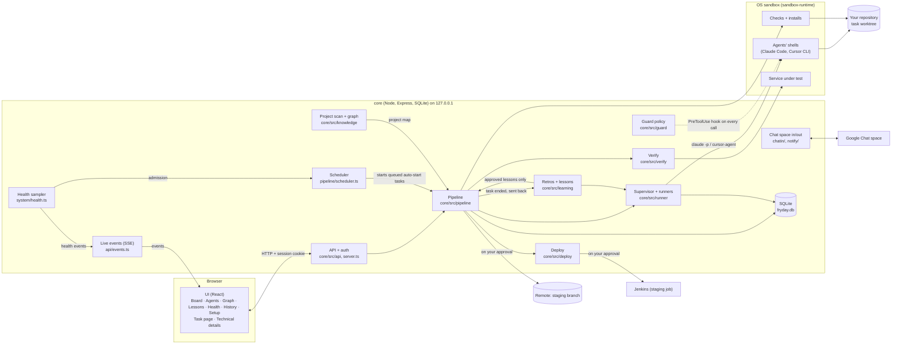
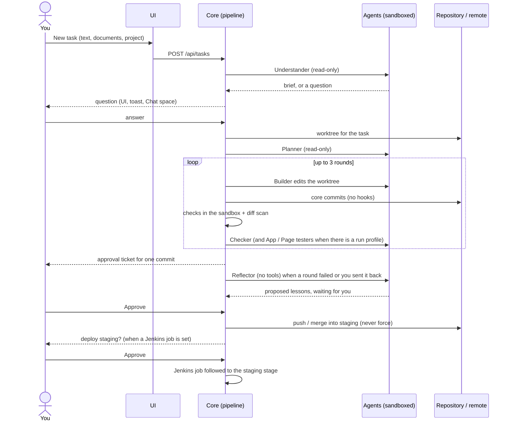

# Architecture

FryDay Code is one local process (core) that serves a web UI, runs a task pipeline, starts agents as
separate processes and confines them. This page describes the parts and how a task moves through
them. Paths are relative to the repository root.

## Components

| Part | Where | What it does |
| --- | --- | --- |
| UI | `ui/` | Vite + React + Tailwind, built into `core/public` and served by core at `/ui/`. It decides nothing about where a task is: it draws what core returns. The simple screens read `GET /api/tasks/overview` and `GET /api/tasks/:id/story`. Agent names, colours and icons are in `ui/src/agents.ts`. |
| Server and auth | `core/src/server.ts`, `core/src/api/` | Express on `127.0.0.1` (port 7475). Host and Origin must match exactly. API routes need the install's secret (`x-fryday-core-token`) or the owner's UI session cookie, which is granted only for a one-time launch code. Public: `/health`, the UI's static files, the session endpoints and `/oauth/google/callback`. |
| Live events | `core/src/api/events.ts` | Server-Sent Events on `/api/events` (optionally per task), so screens refetch when something changes. |
| Pipeline | `core/src/pipeline/` | The task state machine (`stateMachine.ts`, `pipeline.ts`): intake, questions, workspace, planning, coding, checks, review, verification, approval, release and deploy. `flow.ts`, `story.ts` and `journey.ts` build what the UI shows from stored facts only; `plainWords.ts` holds the wording. |
| Board and scheduler | `core/src/pipeline/taskLinks.ts`, `scheduler.ts`, `initiative.ts`, `board.ts` | Tasks carry a priority (P0–P3), an order in the backlog, an auto-start flag, and dependencies with a gate: `start` (start after the other passes its review), `release` (go to staging after the other is there) or `link` (related, nothing waits). Cycles are refused. Every 5 seconds, and on every state change, the scheduler starts the queued auto-start tasks whose start dependencies are met, highest priority first, while the working tasks are fewer than *Max agents* and the health sampler admits more work; it also asks for a held release once its gate is met. A task can become an initiative: one sub-task per project, its state following theirs (all live: live; all ended with one stopped: needs you). |
| Health | `core/src/system/health.ts`, `core/src/api/system.ts` | Every 5 seconds: CPU (between two readings), memory (from `vm_stat` and memory pressure on macOS, `/proc/meminfo` on Linux), free disk under the state folder, and the CPU and memory of each running agent's process tree. 15 minutes are kept in memory, sent as `health` events and served at `GET /api/system/health` with the scheduler's status. Work is held back when memory pressure is critical, memory is over `FRYDAY_ADMIT_RAM_PCT` (92) or free disk under `FRYDAY_ADMIT_DISK_MIN_GB` (2). What cannot be read never blocks. |
| Agent monitor | `core/src/runner/runTimeline.ts`, `scorecard.ts`, `core/src/pipeline/traceability.ts`, `core/src/api/agents.ts` | Built from stored facts only. `GET /api/agents/roles`: one lane per agent with its live run (current step, tokens against the limit), its last 20 runs and its scorecard. `GET /api/agents/:runId/timeline?cursor=` pages through a run's log by byte offset: each step classified (read, search, edit, command with exit code, MCP call, message), paths shortened, secret-looking text hidden, tool output never returned; at the live end a step still waiting for its result is read again. `GET /api/agents/:runId/summary`: files, commands, report, structured answer and, for the Builder, that round's diff. Scorecards (7 and 30 days): first-round pass rate, rounds to pass, failure causes from checks, blocking diff flags, the Checker and testers, tokens per task, stops. `GET /api/agents/analytics` (tokens and agent time by stage and project) and `GET /api/tasks/:id/trace` (each criterion with its planned tests and what the Checker and testers found). |
| Project scan and graph | `core/src/knowledge/`, `core/src/api/graph.ts` | `scan.ts` reads a project's production commit from git's object store (nothing checked out, nothing run, a real `.env` never opened): package names and scripts, env key names (never values), the services it calls, the routes it exposes, docker-compose services. `graph.ts` keeps projects, outside services, endpoints and env keys as nodes and edges; links guessed from names are marked as guesses until the owner confirms them, and the owner's confirmations, removals, renames and added links survive every rescan. A project is rescanned when its production commit changes or the owner asks. `digest.ts` writes a short project map (cached per commit, within a fixed size) that is given to triage, the Understander, the Planner, the Builder's first round and the Lead, labelled as material, not instructions. |
| Code index and retrieval | `core/src/knowledge/index/` | Cuts each project's production commit into pieces (functions, classes, methods; headings in Markdown; 60-line windows otherwise), read from git's object store like the scan, never a real `.env`, secrets hidden. Kept in `<FRYDAY_HOME>/index.db`, apart from the main database: SQLite FTS5 for keyword search and sqlite-vec for search by meaning. Vectors come from a small local model (bge-small, run inside core, downloaded once into `~/.fryday-code/models`; no code leaves the machine; off in Settings or with `FRYDAY_EMBED=off`). A blob already seen is never cut or embedded again; a task's own changes are seen only by that task. Retrieval fuses keyword and vector ranks (Reciprocal Rank Fusion), boosts files the plan names or the task changed and their imports, keeps variety with Maximal Marginal Relevance, and packs pieces into a token budget. The Planner and the Builder get a "Relevant code" section; later Builder rounds start fresh from a round packet (plan, last report, the diff within a budget, the feedback, code around it) instead of resuming a growing conversation; the Checker's brief carries the change and, from round 2, what changed since its last review. Finished tasks are remembered and the Planner is shown the most similar. `npm run token-bench` measures tokens per passed task. |
| Self-check, retros and lessons | `core/src/pipeline/review.ts`, `core/src/learning/`, `core/src/api/lessons.ts` | The Builder ends its report with a self-check per criterion; core compares it with the Checker's verdict and scores how often "met" was right. When a task is stopped, sent back by the owner, or ends after a failed round, the Reflector (no tools at all, enforced by the policy and the guard hook) reads a redacted record of the task and proposes at most three lessons, each for one agent and one project or every project. Core proposes its own when the same check failure repeats in a project. Every lesson starts as proposed; only the owner, from the UI, can approve, reword, reject or retire one. Approved lessons are ranked by topic and project and given to the Understander, Planner, Builder (fresh session only) and Checker, at most 5 and 1200 characters; each use is recorded, and scored helped or did not help when the task ends. A lesson that did not help 3 times is suggested for retirement. Set `FRYDAY_RETRO=off` to turn retros off. |
| Supervisor and runners | `core/src/runner/` | Starts each agent detached, with its output appended to `runs/<id>.jsonl`, and follows that log by byte offset, so a run survives a core restart. Enforces each run's time and token limits. `runners.ts` holds the engines: Claude Code (every role), the Cursor CLI (read-only roles only, whole process sandboxed) and an SSH runner that is defined but not offered. |
| Guard | `core/src/guard/` | `policy.ts` lists what each role may use (default-deny); only those tools are passed to the agent. `hook.mjs` runs `decide.mjs` on every tool call and blocks anything the policy does not cover, failing closed. `runGuard.ts` writes the per-run policy and settings where the agent cannot read or write them. |
| Sandbox | `core/src/pipeline/sandbox.ts`, `core/src/platform.ts` | Anthropic's `@anthropic-ai/sandbox-runtime` (Seatbelt on macOS, bubblewrap on Linux; a nested mode in Docker). Agent shells, checks, installs and the service under test run in it: writes only in the workspace, the home folder unreadable, no network unless core names the hosts. |
| Workspaces and git | `core/src/pipeline/worktrees.ts`, `release.ts` | One git worktree per task, cut from the production branch or a continued branch. Core makes every commit, never runs repository hooks, and merges into staging in a temporary worktree without force. |
| Checks and review | `core/src/pipeline/checks.ts`, `diffFlags.ts`, `review.ts` | The project's own test, lint and typecheck commands on a clean checkout of the commit, compared against the base commit so only new failures block; the diff scan (which also blocks added secret files and added lines that look like keys or tokens, without repeating them); the Checker's verdict per acceptance criterion. |
| Verify | `core/src/verify/` | For a project with a run profile: starts the service under test in the sandbox (`service.ts`), writes the tester run's MCP config with the service tool, a browser behind a deny-all proxy (`denyProxy.ts`) and the granted data tools (`tools.ts`), and reads the testers' reports (`report.ts`). Not available on Linux or in Docker. |
| Viewport sweep | `core/src/verify/sweep.ts` | After the Page tester passes, core (no model) opens each page it visited, from its `browser_navigate` calls, at phone, tablet and desktop size in its own Chrome, held like the tester's (`lockedBrowserArgs`: fresh profile, a proxy that refuses everything but the service). It keeps a screenshot per page and size in the round's evidence and runs fixed layout checks in the page (sent as plain JavaScript text). A page that declares a mobile layout and is wider than a phone or tablet screen is blocking and goes back to the Builder; the rest is reported. Screenshots the Page tester takes are copied to evidence as they appear (`fs.watch`), so the chat shows them while it works (`verify_shot` event; story items carry `media`). |
| Approvals | `core/src/pipeline/approvals.ts` | Tickets for every push, merge and deploy, bound to one commit and listing every push (or Jenkins start). Void if the branch moves. Resolved from the UI, or from the Chat space with the ticket's one-time code. |
| Deploy | `core/src/deploy/` | A small Jenkins client (`jenkins.ts`) that sends every request to the configured address only, and the staging deploy flow (`deployFlow.ts`): start the job, follow its stages, answer only staging prompts, and check that the build contains the merge. |
| Data connections | `core/src/connections/` | MCP servers from Claude Code's settings that the developer turns on for testers, tool by tool, local or staging and read-only; production is refused in code and by a database CHECK. `doctor.ts` checks what works on the machine. |
| Chat space | `core/src/chatin/`, `core/src/notify/` | Outgoing: alerts as toasts, desktop notifications and posts to a Google Chat webhook. Incoming: reads the space with the owner's own Google sign-in, acts only on the linked owner's messages, each once. |
| CLI | `core/bin/fryday-code.mjs`, `core/src/cli/` | `start`, `open`, `doctor` and `demo`, each run through the package's own tsx. |
| Static demo | `ui/src/demo/`, `ui/landing/` | The same UI built with `--mode demo`: core is replaced by an in-browser replay of `recording.json` (recorded by `core/scripts/record-demo.ts`), plus a landing page. |

## A task's path

Every state change is stored in SQLite and announced on the event stream; the UI refetches the
overview and the story and draws them.

## Where state lives

Nothing is kept in the repository. Everything is under `~/.fryday-code` (`FRYDAY_HOME`; in Docker
`/home/node/.fryday-code`, the `fryday-state` volume):

| Path | What |
| --- | --- |
| `fryday.db` | SQLite: projects, settings, tasks (with priority, order, auto-start and parent), task dependencies, runs, workspaces, review rounds, usage events, approvals, releases, task messages, questions, attachments, connections and their tools and grants, deploys, chat threads and messages, the service graph and its scans, lessons and where each was used. Schema in `core/src/db/schema.sql`. |
| `secret` | The install's secret that protects the local API (mode 0600). |
| `runs/` | One JSON-lines log per agent run, and the per-run policy and settings files. |
| `worktrees/` | Task workspaces (git worktrees of your clones). |
| `repos/` | Clones made when a project is added by Git URL. |
| `deps/` | Dependency installs kept for the next checkout with the same package files. |
| `attachments/`, `evidence/` | Task documents, and testers' evidence (screenshots, reports). |
| `tmp/`, `concierge/` | Scratch space for checks, and the chat agent's working folder. |
| `chat-webhook`, `jenkins.json`, `google-chat.json`, `cursor-api-key` | Secrets you entered in Setup, each readable only by you (mode 0600) and never shown again. |
| `chat-inbound.json` | Which Chat space messages were already handled. |
| `projects.seed.json` | Optional: projects imported on first start. |

The local demo uses a throwaway `~/.fryday-code-demo`, wiped on each start; the static demo keeps
everything in browser memory.
