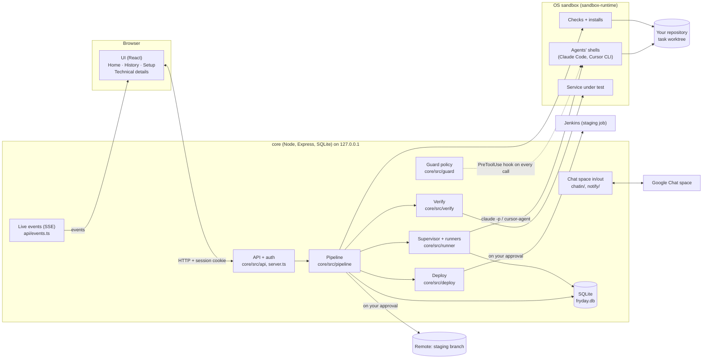
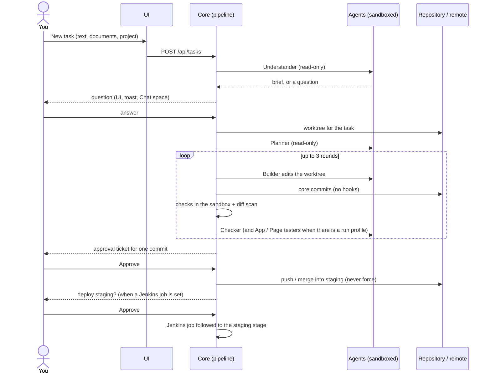

# Architecture

FryDay Code is one local process (core) that serves a web UI, runs a task pipeline, starts agents as
separate processes and confines them. This page describes the parts and how a task moves through
them. Paths are relative to the repository root.

## Components

| Part | Where | What it does |
| --- | --- | --- |
| UI | `ui/` | Vite + React + Tailwind, built into `core/public` and served by core at `/ui/`. It decides nothing about where a task is: it draws what core returns. The simple screens read `GET /api/tasks/overview` and `GET /api/tasks/:id/story`. Agent names, colours and icons are in `ui/src/agents.ts`. |
| Server and auth | `core/src/server.ts`, `core/src/api/` | Express on `127.0.0.1` (port 7475). Host and Origin must match exactly. API routes need the install's secret (`x-fryday-core-token`) or the owner's UI session cookie, which is granted only for a one-time launch code. Public: `/health`, the UI's static files, the session endpoints and `/oauth/google/callback`. |
| Live events | `core/src/api/events.ts` | Server-Sent Events on `/api/events` (optionally per task), so screens refetch when something changes. |
| Pipeline | `core/src/pipeline/` | The task state machine (`stateMachine.ts`, `pipeline.ts`): intake, questions, workspace, planning, coding, checks, review, verification, approval, release and deploy. `flow.ts`, `story.ts` and `journey.ts` build what the UI shows from stored facts only; `plainWords.ts` holds the wording. |
| Supervisor and runners | `core/src/runner/` | Starts each agent detached, with its output appended to `runs/<id>.jsonl`, and follows that log by byte offset, so a run survives a core restart. Enforces each run's time and token limits. `runners.ts` holds the engines: Claude Code (every role), the Cursor CLI (read-only roles only, whole process sandboxed) and an SSH runner that is defined but not offered. |
| Guard | `core/src/guard/` | `policy.ts` lists what each role may use (default-deny); only those tools are passed to the agent. `hook.mjs` runs `decide.mjs` on every tool call and blocks anything the policy does not cover, failing closed. `runGuard.ts` writes the per-run policy and settings where the agent cannot read or write them. |
| Sandbox | `core/src/pipeline/sandbox.ts`, `core/src/platform.ts` | Anthropic's `@anthropic-ai/sandbox-runtime` (Seatbelt on macOS, bubblewrap on Linux; a nested mode in Docker). Agent shells, checks, installs and the service under test run in it: writes only in the workspace, the home folder unreadable, no network unless core names the hosts. |
| Workspaces and git | `core/src/pipeline/worktrees.ts`, `release.ts` | One git worktree per task, cut from the production branch or a continued branch. Core makes every commit, never runs repository hooks, and merges into staging in a temporary worktree without force. |
| Checks and review | `core/src/pipeline/checks.ts`, `diffFlags.ts`, `review.ts` | The project's own test, lint and typecheck commands on a clean checkout of the commit, compared against the base commit so only new failures block; the diff scan; the Checker's verdict per acceptance criterion. |
| Verify | `core/src/verify/` | For a project with a run profile: starts the service under test in the sandbox (`service.ts`), writes the tester run's MCP config with the service tool, a browser behind a deny-all proxy (`denyProxy.ts`) and the granted data tools (`tools.ts`), and reads the testers' reports (`report.ts`). Not available on Linux or in Docker. |
| Approvals | `core/src/pipeline/approvals.ts` | Tickets for every push, merge and deploy, bound to one commit and listing every push (or Jenkins start). Void if the branch moves. Resolved from the UI, or from the Chat space with the ticket's one-time code. |
| Deploy | `core/src/deploy/` | A small Jenkins client (`jenkins.ts`) that sends every request to the configured address only, and the staging deploy flow (`deployFlow.ts`): start the job, follow its stages, answer only staging prompts, and check that the build contains the merge. |
| Data connections | `core/src/connections/` | MCP servers from Claude Code's settings that the developer turns on for testers, tool by tool, local or staging and read-only; production is refused in code and by a database CHECK. `doctor.ts` checks what works on the machine. |
| Chat space | `core/src/chatin/`, `core/src/notify/` | Outgoing: alerts as toasts, desktop notifications and posts to a Google Chat webhook. Incoming: reads the space with the owner's own Google sign-in, acts only on the linked owner's messages, each once. |
| CLI | `core/bin/fryday-code.mjs`, `core/src/cli/` | `start`, `open`, `doctor` and `demo`, each run through the package's own tsx. |
| Static demo | `ui/src/demo/`, `ui/landing/` | The same UI built with `--mode demo`: core is replaced by an in-browser replay of `recording.json` (recorded by `core/scripts/record-demo.ts`), plus a landing page. |

## A task's path

Every state change is stored in SQLite and announced on the event stream; the UI refetches the
overview and the story and draws them.

## Where state lives

Nothing is kept in the repository. Everything is under `~/.fryday-code` (`FRYDAY_HOME`; in Docker
`/home/node/.fryday-code`, the `fryday-state` volume):

| Path | What |
| --- | --- |
| `fryday.db` | SQLite: projects, settings, tasks, runs, workspaces, review rounds, usage events, approvals, releases, task messages, questions, attachments, connections and their tools and grants, deploys, chat threads and messages. Schema in `core/src/db/schema.sql`. |
| `secret` | The install's secret that protects the local API (mode 0600). |
| `runs/` | One JSON-lines log per agent run, and the per-run policy and settings files. |
| `worktrees/` | Task workspaces (git worktrees of your clones). |
| `repos/` | Clones made when a project is added by Git URL. |
| `deps/` | Dependency installs kept for the next checkout with the same package files. |
| `attachments/`, `evidence/` | Task documents, and testers' evidence (screenshots, reports). |
| `tmp/`, `concierge/` | Scratch space for checks, and the chat agent's working folder. |
| `chat-webhook`, `jenkins.json`, `google-chat.json`, `cursor-api-key` | Secrets you entered in Setup, each readable only by you (mode 0600) and never shown again. |
| `chat-inbound.json` | Which Chat space messages were already handled. |
| `projects.seed.json` | Optional: projects imported on first start. |

The local demo uses a throwaway `~/.fryday-code-demo`, wiped on each start; the static demo keeps
everything in browser memory.
